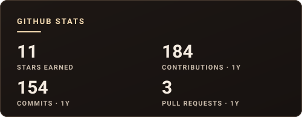

  

  
  
  
  

---

### Hi! 👋

I'm **Ravi Shankar** — a **Senior AI Engineer** passionate about designing robust, intelligent systems and bridges between modern AI models and production applications. 

- 🚀 **Focus** — LLM systems, Agentic workflows, distributed services, and intelligent software
- 💻 **Stack** — React, Kotlin, Node.js, Python, TypeScript
- 🔬 **Building** — High-performance AI pipelines, edge architectures, and real-time interfaces
- 💬 **Ask me about** — Full-stack architectures, GenAI application design, reactive patterns, and system scaling

<!-- DYNAMIC-STATS:START -->
<!-- Generated automatically by scripts/render_readme.py - edit the script, not this block. -->

| ⚡ Metric | Value |
| :--- | :--- |
| 📦 **Public Repositories** | `41` |
| 🔥 **Yearly Contributions** | `187` |
| 💻 **Yearly Commits** | `157` |
| 🔀 **Pull Requests** | `3` |
| ⭐ **Total Stars Earned** | `11` |

Auto-synced via GitHub GraphQL API · Refreshed 21 October 2026
<!-- DYNAMIC-STATS:END -->

---

### 🏆 GitHub Activity

  
  

  <picture>
    <source media="(prefers-color-scheme: dark)" srcset="https://raw.githubusercontent.com/ravishu5/ravishu5/output/github-snake-dark.svg">
    <source media="(prefers-color-scheme: light)" srcset="https://raw.githubusercontent.com/ravishu5/ravishu5/output/github-snake.svg">
    
  </picture>

